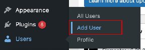
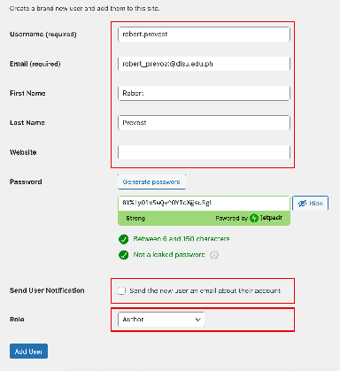
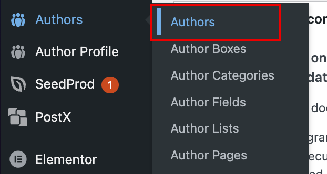
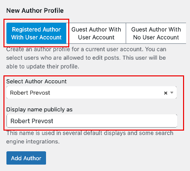

### 3.2.1. Adding Authors for Articles

Before an author can be assigned to an article, they must have both a user account and an author profile in WordPress. This two-part process involves creating the user first, then linking it to a public author profile. These accounts are for attribution purposes only; authors will not use them to log in.

**A. Create a New User Account**

1. **Navigate to the “Add New User” page.** On the left sidebar, go to Users > Add New.  
     
     
2. **Fill out the new user’s details.** Follow this specific format:  
* **Username**. Use the author’s DLSU email prefix, replacing any underscore (_) with a period (.). For example, **robert_prevost** becomes **robert.prevost**  
* **Email.** Enter the author’s full DLSU email address  
* **First name and last name.** Enter the author’s preferred byline. If unsure, ask the Web Editor, the author’s section editor, or the author themself. The combined first and last name will be the public-facing byline on the website  
* **Website.** Leave blank

3. **Keep the randomly generated strong password.**   
     
4. **Disable the user notification email.** Uncheck the box labeled “Send the new user an email about their account.” This prevents sending unnecessary login details for an account they will not use.  
     
5. **Set the user role.** Using the drop-down menu, set the role to “Author”  
     
     
6. **Add the user**. Click the “Add New User” button to complete the account creation.

**B. Create the Author Profile**

1. **Navigate to the “Authors” page**. On the left sidebar, go to Authors > Authors.  
   

2. **Create a new author profile.** On the “New Author Profile” section on the left portion, ensure “Registered Author With User Account” is selected.

3. **Select the user to map.** On the “Select Author Account” dropdown menu, find and select the user you just created in Part A.

4. **Confirm the display name.** Once selected, the “Display name publicly as” field should automatically show the correct byline. Verify that it is correct.  
   

5. **Add the author.** Click the “Add Author” button. The author will now appear in the list on the right and will be available to select when you are uploading or editing an article.

### 3.2.2. Authentication & Single Sign-On (SSO)

Beginning in TLS65, to adhere to the principle of least privilege, general Web staffers are assigned **Editor** roles on WordPress rather than Administrator. Administrator access is restricted to the Web Editor, designated technical leadership, and system administrators.

Starting in TLS65 Term 3, WordPress login was migrated away from local password logins and Wordfence 2FA entirely to centralized Single Sign-On (SSO) powered by **Authentik** (`auth.thelasallian.com`). Password login has been disabled on WordPress; account provisioning and role-based access to WordPress and other internal services are managed centrally through Authentik by the Web Editor.

#### Logging in via SSO:
1. Navigate to the WordPress login page at [thelasallian.com/wp-admin](http://thelasallian.com/wp-admin).
2. Click the **Log in with Google** button (which authenticates through our Authentik identity provider).
3. Sign in using your registered TLS Google Workspace account. Once authenticated, you will be redirected back into the WordPress dashboard with your assigned role permissions.

*(Legacy Reference: In prior terms through Web 62–65 T2, staffers logged in with direct passwords and two-factor authentication was managed directly on WordPress using the Wordfence Login Security plugin with time-based one-time passwords [TOTP]).*
